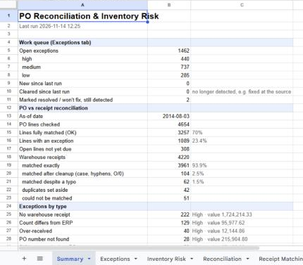
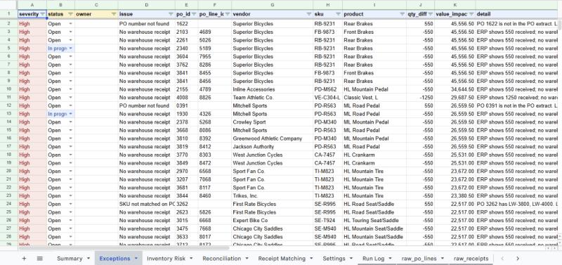
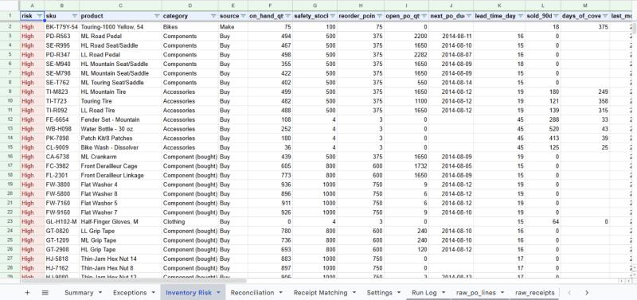
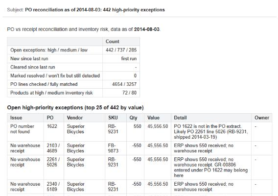

# PO vs Receipt Reconciliation & Inventory Risk

SQL Server extracts feed a Google Sheet, where Apps Script checks every purchase-order line
against the warehouse receiving log, flags inventory at risk of running out or sitting idle,
keeps a shared work queue of the issues, and drafts a daily email report.

> Personal portfolio project, built with AI assistance (Claude). The data is Microsoft's
> AdventureWorks sample database; the warehouse receiving log is **simulated** (see below).

## Screenshots

**Summary**: one page with the work queue, matching results and exceptions by type.



**Exceptions**: the shared work queue. Severity, value and suggested action are filled in by the script;
status, owner and comment (yellow headers) are filled in by people and kept on every rerun.



**Inventory Risk**: stockout and slow-stock flags per product, with planning parameters and stock by location.



**Email report**: created as a Gmail draft for a person to review and send (sample data shown).



## What it does

| Check | Example |
|---|---|
| Receipt vs ERP quantity | Warehouse counted 2, ERP shows 3 received |
| Missing / unknown receipts | ERP shows goods received but no warehouse record; receipt quotes a PO that doesn't exist (and the likely right PO is suggested) |
| Short / over / rejected deliveries | 468 of 550 delivered and PO closed; 550 of 550 rejected at receiving |
| Late deliveries, overdue open POs | Received 9 days after the due date |
| Duplicate scans | Same PO, SKU, quantity and day entered twice |
| Typo-tolerant SKU matching | `fw7160`, `FW-716O`, `FW-1760` are all matched to `FW-7160`; ambiguous ones go to a person |
| Stockout risk | Below safety stock, at reorder point with nothing on order, days of cover shorter than lead time |
| Slow / dead stock | No movement for 180+ days, discontinued items still in stock, with location breakdown |

| Automation | |
|---|---|
| Work queue | Status, owner and comment on each exception survive every rerun; the Summary shows new and cleared issues since the last run |
| Daily run | Time-driven trigger runs import → checks → summary at a set hour |
| Email report | Gmail **draft** with counts, the top open high-priority exceptions, high-risk stock and a CSV of every open exception. A person reviews and sends it |
| Run Log | Every run (menu or schedule) is logged with user, duration and result |

Tabs: **Summary**, **Exceptions** (the work queue), **Inventory Risk**, **Reconciliation** (every PO line),
**Receipt Matching** (how each receipt was matched), **Settings**, **Run Log**, and the raw imported data.

## How it works

```
SQL Server (AdventureWorks2022)
   │  sql/01-04_*.sql            extract PO lines, receipts, stock by location, product master
   ▼
export.ps1  ──►  data/*.csv      UTF-8, locale-independent numbers
   │             (-CopyTo a Google Drive for desktop folder = no manual upload)
   ▼
Google Drive folder
   │
   ▼  menu click or daily trigger
Google Sheet + Apps Script       import → reconcile → inventory risk → summary → Gmail draft
```

**Design choices**

- **SQL prepares facts, Apps Script applies rules.** Thresholds live in the Settings tab, not in the code.
- **SKU matching only compares SKUs on the same PO**, so typo tolerance can't drift onto an unrelated item.
  A real team script failed because one wrong character stopped files from matching; this avoids that without guessing.
- **One shared queue instead of copies.** Notes are keyed to each exception, so a rerun never wipes them,
  and sub-teams filter by owner instead of keeping separate sheets that drift apart.
- **One run at a time:** every run takes a document lock, so two people pressing the button can't overwrite each other.
- **Drafts, not sends, and least privilege.** The report uses the Gmail API's `gmail.compose` scope (create drafts only),
  Drive is read-only, and the spreadsheet scope is limited to this one file.
- **Logic is testable outside Google:** matching, checks, tracking and the email body are pure functions that run under Deno.

## In production, I would change

- **Source:** read the ERP / WMS directly (or a scheduled database export) instead of a fixed 2014 snapshot,
  and run `export.ps1` from Windows Task Scheduler just before the Sheet's daily run.
- **Scale:** Apps Script runs are capped at 6 minutes. At tens of thousands of lines I'd move the matching
  into SQL or BigQuery and keep the Sheet as the work queue and report.
- **Receipts:** take the receiving log from handheld scans so typos become rare, and keep the fuzzy matching as a safety net.
- **Access:** protect the generated columns so only status, owner and comment are editable.

## Simulated data

AdventureWorks has purchase orders but no separate warehouse receiving log, so
[`sql/02_warehouse_receipts.sql`](sql/02_warehouse_receipts.sql) builds one from the received PO lines and plants
realistic mistakes in a small, repeatable share of rows: mistyped SKUs (~4%), short and over counts, missing receipts,
duplicate scans, mistyped PO numbers and late arrivals. The sample data ends in August 2014, so "today" is fixed at
**2014-08-03** (editable in Settings), and POs not shipped by then are shown as still open.

## Test results

`tests/logic_test.js` runs the Apps Script logic against the sample CSVs and an answer key of the planted mistakes:

```
check                                               caught / planted
short count -> count mismatch                         128 / 128
late delivery -> flagged                              391 / 391
missing receipt -> flagged                             87 / 87
mistyped SKU -> matched to right line                 166 / 166
over count -> over-received / mismatch                 41 / 41
mistyped PO -> flagged                                 44 / 44
mistyped PO -> right PO suggested                      44 / 44
duplicate scan -> set aside                            42 / 42
mistyped SKU, 2 close options -> sent to review         7 / 7
received after as-of date -> no receipt                84 / 84
receipts matched to the wrong line                      0
false alarms on clean lines                             0
```

Further tests cover the work queue across two runs, unique exception keys, and the email body (escaping, truncation, CSV quoting).

## Setup

### 1. Export the data (optional: sample CSVs are already in `data/`)

Needs SQL Server with [AdventureWorks2022](https://learn.microsoft.com/sql/samples/adventureworks-install-configure) restored.

```powershell
powershell -ExecutionPolicy Bypass -File .\export.ps1                                   # default server .\SQLEXPRESS
powershell -ExecutionPolicy Bypass -File .\export.ps1 -Server "MYPC\SQL2022"            # another instance
powershell -ExecutionPolicy Bypass -File .\export.ps1 -CopyTo "G:\My Drive\po-recon"    # also copy into a synced Drive folder
```

### 2. Put the CSVs in Google Drive

Create a Drive folder and upload the four files from `data/` (or let `-CopyTo` do it through Google Drive for desktop).
Uploading a newer version later is fine: the import always takes the most recently updated file of each name.

### 3. Create the Sheet and add the script

1. Create a new Google Sheet and open **Extensions → Apps Script**.
2. **Project Settings** (gear icon) → tick **Show "appsscript.json" manifest file in editor**.
   Open `appsscript.json` and replace its contents with [`apps-script/appsscript.json`](apps-script/appsscript.json).
   This sets the time zone, the permissions and the Gmail service.
3. Run `powershell -ExecutionPolicy Bypass -File .\bundle.ps1`. It joins `apps-script/*.gs` into `dist/Code.gs`
   and copies it to the clipboard. Select everything in `Code.gs`, paste, and save.
4. Reload the Sheet. A **PO Reconciliation** menu appears.

### 4. Run it

1. **PO Reconciliation → Set up Settings tab.** Google asks for permission the first time.
2. Paste the Drive folder link into **CSV folder** on the Settings tab. Optionally set **Report email to**.
3. **PO Reconciliation → Run everything.**
4. Work the **Exceptions** tab: set status, owner and comment (yellow headers). They are kept on every rerun.
5. **4. Create report email draft** puts the report in Gmail → Drafts.
6. **Turn on daily run** schedules the whole pipeline at the hour in Settings; the draft is created automatically.

### Run the tests

```powershell
deno test --allow-read tests/
```

To rebuild the answer key after changing the SQL: `.\export.ps1 -SqlDir .\tests\sql -OutDir .\tests\data`.

## Repository layout

```
sql/            extract queries (01-04)
export.ps1      runs sql/*.sql, writes data/*.csv (optionally copies them to a Drive folder)
data/           sample CSVs (as of 2014-08-03)
apps-script/    Apps Script source, one file per module, plus appsscript.json
bundle.ps1      joins apps-script/*.gs into dist/Code.gs for pasting
tests/          Deno tests + answer key of planted mistakes
```
